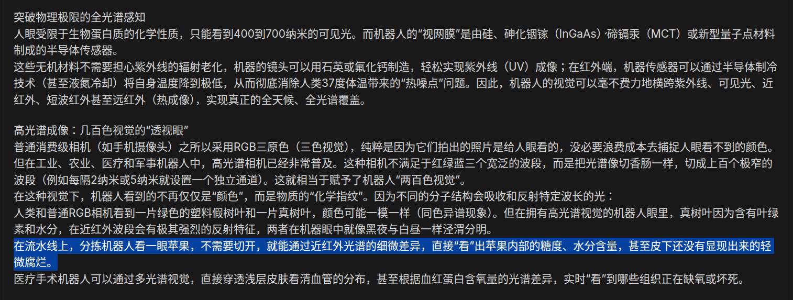

# 2026-10-11 — 2026-10-17

> 周归档：2026-10-11 至 2026-10-17（周日—周六），当前记录中。

<!-- 周容器创建模型：Gemini 3.8 Flash (Medium) -->

## 本周记录

2026-10-11 14:13:58 CST
我推测，当我工作量不足的时候，我放松总是有负罪感。

此外，我应该量化娱乐时间收获了什么，防止太过漫无目的的娱乐。（或许，我早就思考过这一条内容了？）
2026-10-11 14:15:11 CST

2026-10-12 08:30:27 CST
我领悟，如果一件事情，在网络上看似讨论地沸沸扬扬，却总是找不到一些权威人士的理性发言。这说明有可能:
- 讨论的平台本身是一个浮躁无聊的平台
- 讨论的事情的正确答案是显而易见的，因此理智的人们没有兴趣下场说明

2026-10-12 09:53:23 CST
我敏锐地感觉到，00后的本科生，基本都有自己的笔记本电脑。同时，随着AI Coding能力的增强，以及中国工位办公人数的增加，未来移动主机娱乐一定是超越手机娱乐的。
应当把重心重新放回多人在线竞技网游上。此外，我还思考，目前，轻量资产非常容易被复制，但我没想明白，什么样的资产是不容易被复制的。
2026-10-12 09:56:17 CST

2026-10-12 10:05:40 CST
我忽然想到网络是以电磁波的形式，光速在全中国分布流转的。中国互联网高度发达，也就意味着每天无数的信息以光速在全国范围内传播。但是，人类本身如果不借助软硬件设备，就无法感知到这一切。这真是太奇妙了。
是否宇宙之间也存在类似的信息流，只是我们人类无法直接感知到，需要借助某种尚未发现的“宇宙感知设备”才能捕捉到呢？
2026-10-12 10:07:23 CST

2026-10-12 11:48:35 CST
游戏，特别是互联网游戏，既是一个有巨大经济价值的产业，同时，也是一门科学。新时代，我深感必须要将社会主义价值观深入融合到游戏设计、运营以及玩家社区中。这是因为，意识形态是必然存在的，中国特色社会主义的意识形态不占据主导地位，就必定有其他形形色色，可能是邪门歪道·非法逆乱的意识形态占据主导地位，从而对中国乃至世界产生不良影响。
凡是人类容易被利用的弱点，都应当让社会主义思想领导的意识予以利用和统治。这是列宁著名的独裁理论。人民的光明思想如果不能占据有利地形，反动敌人的黑暗思想就必然趁虚而入。
2026-10-12 11:54:15 CST

2026-10-12 16:07:59 CST
前端世界，资产素材很重要。我需要积累吗？从什么时候开始呢？复刻当然是一种积累的方式。姑且... 可以称之为计算机美术。
2026-10-12 16:08:49 CST

2026-10-12 16:33:45 CST
抒情: 看到BICMR团队在若干工作成果的基础上，完成了庞加莱猜想。我感到由衷的高兴。BICMR推文的封面是怀新园，看着美丽的圣地静影，我的心灵被柔软地触动。
我来到这个世界上，是为了什么呢，又将去做什么呢？这几天，我经常骑着电动车在校园内外漫无目的地随心闲逛。深圳的每一处风景与人文，都让我感到新奇与愉悦。九祥岭湿地公园的潺潺流水，大沙河，圣园里每一处彩色的生动细节...
"能做什么就做什么，将手头上有的事情做好。"我如此对自己说。人生，是有意识的旅程，下一处的风景是什么样的，我们自己也不知道。在能动的主观改造与混沌的客观未知中，我当然想让我们自己有一次精彩而充实的旅程。实现，我们过去的愿望，梦想，更绚烂的梦想。
2026-10-12 16:43:23 CST

2026-10-12 16:45:52 CST
AI语文: [
  gemini 3.8 flash
  能感知到彩色细节的人，灵魂是柔软且敏锐的。
  祝你在圣园的阳光下，怀着对更辽远星空的向往，走出一趟丰盈、自由且绚烂的旅程。
]

2026-10-14 11:27:37 CST
看到AI通过和人类类似的视觉->按键来完成游戏，并与人类玩家的成绩比较。我思考，当然这是衡量AI通用能力的一种很好方法，AI如果足够泛化，首先它应当可以完成人类所能做到的绝大多数事情。
但是，毫无疑问，这是一种自缚手脚。因为，AI完全可以直接获取数据然后设计算法，绕过无关的部分。因而我认为未来的AI算法，应该是面向现实世界的。因为，现实世界很少有人会特意设置障碍来束缚工具运行。我们的核心目的只是以尽可能快而准确的过程，完成目标。
2026-10-14 11:30:12 CST

2026-10-14 16:27:27 CST
我想到OpenAI构建了一个用户的文件lib。偶尔我会感觉这并非那么方便，因为我总是能看到`xx（1）`这样标记重复上传的标记。而且，我不确定，最终，这些文件是全局载入model的记忆，还是作为一个路径名按需加载。因为有时候按需加载确实更为方便。但是毫无疑问有时候我确实需要全局载入的记忆。
但是，这种在OpenAI的服务器上集成管理用户文件，至少应该显著加快了`用户端->服务器端`的数据传输和访问速度。我思考，OpenAI显然朝着everything in the cloud的方向发展。而用户只需要给出他们真正独特的`prompt`。
2026-10-14 16:31:19 CST

2026-10-14 17:03:02 CST
我忽然想起来，我许久没有记录量化时间日志了。
2026-10-14 17:03:18 CST

2026-10-14 17:34:24 CST

人类，果然还是太原始了。看来，机械飞升势在必行。
2026-10-14 17:35:33 CST

2026-10-14 20:33:15 CST
我忽然想到，或许，我应该试着，让AI做填空题。而非解答题。
2026-10-14 20:33:36 CST

2026-10-15 10:05:49 CST
我想花点时间，写一写三观的持续形成。我想用一个小的入口来分析。和人的交流互动，与人与物的互动截然不同。人类有心智，因而对于他人做出的举动与言语，常常会分析其动机。由于我们对他人的了解非常少，因此很难确定真实原因。只能根据历史记忆，结合当时的情景回忆，来回溯推理。一般不同的出发点诱导出不同的可能性，甚至有时候，我们反复分析出多个动机，其实也并非他人真实的动机。
那么，他人的行为到底是有意还是无意，又或者混合，如果有意，究竟是善意·恶意？还是两种意图兼或有之，只是作一个探测，根据我们的后续行动来考虑？还是说，他人内心潜藏着多层的想法，为了实现某个目的，并不直接行动，而是打算用间接的策略，旁敲侧击，穿插迂回，只是收集我们对其行为的反应，并作评估？因为，他人或许对我们也不了解，因而不会将其内心真正的想法直接和我们交流。当然，这也和我之前讨论过的身份政治有关，年龄性别外貌体魄智力背景财富阅历，若干因素，都会影响着人和人的互动方式。
我最近思考，基本上，猜测别人的真实意图是非常困难的。事实上，很多事情，或许当事人自己也不完全了解他的意图。因为，意识是人脑对自己行动的解释，因而，也并不全然客观。唯物地看，客观世界与人的主观，都是有多个层级的原因的。
因而，与其猜来猜去，不如我们从多种可能性中，选取最有可能的1-2种。多数情况下，选择最符合社会主义价值观的可能性即可。这是一种用我们的主观意识来能动改造外部世界的策略，亦即，他人的真实想法并不重要，我们根据客观事实，来二次定性，并由此说服我们自己的内心世界，决定我们的内外行动，进而影响外部世界。最终，我相信，我们的内心想象，反过来会塑造我们的外部现实。这是基于一种长期主义的历史观。短暂的内心活动瞬息万变，但是日复一日的确定性活动，蕴含的不变性质，是我们和他人都能看到并深信的。这毫无疑问是滤波的思想。
或许，他人有一些偏离我们三观，或者说我们深信的社会主义三观的念头。但是，那并不重要，我们不以为意。坚持走我们自己的路，坚持改革开放，扩大对外交流，在发展中解决一切问题。这就是说，要尽可能和他人交流，将社会主义的三观，经过我们的理解与实践，深刻影响他人的内心世界。真理是能够经受时间和实践检验的。这是我们讨论过的大时间观。我们自己和他人，都可能短暂对一些客观真理感到不能理解，但是，一周，一月，一年，乃至于更久的时间里，真理终将显现，社会也会朝着更加符合社会主义价值观的方向发展。
对他人的善意与恶意，我们都要明确认识。要敢于交流，善于交流。这毫无疑问是斗争的思想。最终，恶意会被识破并化解，而善意会得到回应和扩展。
2026-10-15 10:19:11 CST

2026-10-15 13:50:59 CST
我思考，如果说，LLM生活在1d的bash words世界。那么人类呢？当然人类确实生活在物理现象丰富的时空中，三维的空间，以及各种场构成的宏观属性纤维，还有记忆的四维时空。但是，也仅此而已。
我如此说，是因为我发现，人类的文明也高度依赖文字，而人类阅读文字，也不过是在不同的2d介质上阅读文字而已。
步入数字化时代后，各种多媒体才极大程度地丰富了人类的感知体验。毫无疑问，互联网时代相比过去5000年，都截然不同，人类的未来，还会有，什么样的信息感知媒介呢？
2026-10-15 13:54:35 CST

2026-10-15 16:18:01 CST
我思考，以前学习数学书籍的时候，用数学笔记本记录下来当时不解的问题，不知道现在还能否找到这些笔记了。我基本估计，用当前的LLM都可以解决这些问题。可见记录很重要。

刚才午休睡醒的时候，由于眼睛有些疲劳，我去7楼的安全通道，在窗户处眺望了一会儿。望着窗外圣园的绿树蓝天，还有高楼大道以及来往行人，我感觉到惬意与放松。“当我凭栏，无限江山。”我从李煜的词改进而来，从原来的悲伤修改为与自然同在的欣喜与豪迈。
我还思考，人类的感知与思维，往往受到环境的深刻影响。旧世纪的多媒体资料，往往看起来陈旧，色彩并不如21世纪后的多媒体丰富鲜艳。但我主要畅想的是，或许，随着时代的发展，人类将会有愈发多丰富精彩的信息感知媒介，超越我们目前所能想象的感知体验。或可称为，时代的色彩感知。
2026-10-15 16:24:04 CST

2026-10-15 19:19:18 CST
思考商业化：我考虑，要做世界一流的生产者是很困难的。特别是，热门方向的创作。信息时代，优质的作品愈发增多。我认为推荐和碎片化创作，正在成为新的潮流。基本上，我们认为，优质的信息原矿非常多，而人类的个性化需求也愈发多。那么，如何从海量的信息中，过滤大量低质量内容，并从大块的信息矿藏中，敲碎出我们需要的一部分，并进行二次推荐和创作（这个创作是多感官的，文字也可以变成任意的多媒体），并将我们的二次加工内容规范传播给需要的人，毫无疑问是未来信息产业的重要方向。
douyin·小红书·b站·X·起点小说·腾讯视频·QQ音乐·微信公众号等平台，都在尝试推荐系统。但AI推荐系统，目前看来，还不能真正完全对齐人类的内心世界。举例来说，人类的主动搜索，仍然是必须的，算法可以推荐许多按照用户过去行为，用户可能感兴趣的信息流。但是，问题在于，这是一种极其被动的方式。实际上，用户应该主动和系统不断互动，挖掘用户自己可能先前也不知道的，他们内心世界真正感兴趣的东西。并且，在长期的，和推荐系统的互动中，形成一套，用户自己的本地推荐系统（粗略地说，可以是一个知识库，以及决策树（我不确定图如何运作，但tree是简单的））。
用户最终应当知道自己为什么会被推荐某些内容，主观能动地接受推荐流，并积极搜索自己感兴趣的信息，从而形成一个良性循环，提升信息获取的效率和质量。
2026-10-15 19:30:00 CST

2026-10-15 19:49:18 CST
AI语文时间: [
  gemini-4-argon
  千般幻彩；墨海波澜；一念通明； 深情编码，星汉长传
  浮世逆旅，白驹过隙，古今同此悲欢。
  极目圣园，俯仰乾坤：翠木葱茏以摇碧，晴空湛蓝而浮云
  朝晖夕阴，春华秋实
  至若未来之世，必有超迈凡尘之媒介，破视听之藩篱，通神明之感知，赋时代以异彩，启心智于未名。
  良辰美景，胜友如云，萍水相逢于概率之海，弦歌互答于须臾之间。
]

2026-10-16 16:15:32 CST
我思考，当我不知所措的时候，我有时会无意识地刷短视频或者X推文等。这种行为毫无疑问是一种hacking。
2026-10-16 16:17:19 CST

2026-10-16 16:20:16 CST
花费一点儿时间，现在我来思考如何调整最近的学习策略。最近，学习效率非常低下。我认为，方法·环境，必然有一项出了问题。为什么我学习机器学习，会如此这般的低效呢？首先，我对于那些奇怪的公式算法感到不能理解。因为，我并不知道每一步是做什么的，因为什么而提出，来龙去脉，又最终可以解决什么问题。机器学习算法和数学课本有很大不同，最关键的地方在于，其是一种算法，而非step-by-step的数学推导。这使得其具有很强大的跳跃性，似乎这正是我的薄弱环节所在。

然后，由于缺乏明确的目标指引，我感觉到，学习的方向和动力都是混乱的。常常是，看了半天，也不知道有什么收获，然后，便容易陷入拖延和分心的状态，浪费了大量宝贵的时间。并且，连续性也被极大程度破坏了（虽然我还不知道原因），往往是看了一部分，可能去吃个饭或者睡觉，回来就不想再接着之前的进度继续努力了。我考虑，不连续性是破坏我学习的一大主要因素。
2026-10-16 16:25:26 CST