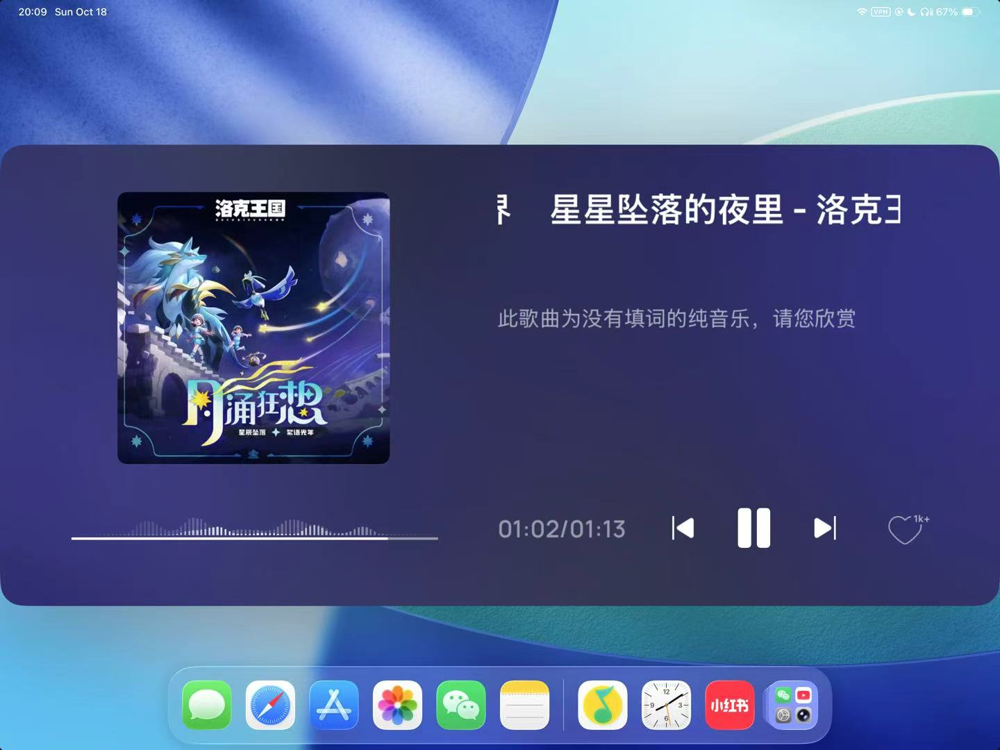

# 2026-10-18 — 2026-10-24

> 周归档：2026-10-18 至 2026-10-24（周日—周六），当前记录中。

<!-- 周容器创建模型：Claude Opus 5.5 (Medium) -->

## 本周记录

2026-10-18 18:56:45 CST
我发现，梦境中，如果人没有做清醒梦，往往面对梦境中发生的事情，思维和清醒的时候截然不同，而人对此不会感到任何异常。
人的记忆无疑是很奇妙的，今天我去dji深圳湾旗舰店，因为昨天无人机撞到工大信息楼后，我要找线下售后传输我飞行眼镜中的数据，看到之前卖给我无人机的导购，我立刻就认出他了。而当然导购的这张脸，日常情况是不会出现在我的思维空间的。
包括人愤怒·悲伤·喜悦的时候，思维和行为都会截然不同。梦境中，人负责理性思考的区域休眠了，所以，梦境时候的人，和清醒活跃时刻的人当然不一样。
所以，究竟什么是“人”本身？我持续思考这个问题。但毫无疑问，人没有想象中那么了解我们自己，生活中庞大的记忆碎片，头脑的不同区域激活程度，都会极大程度影响我们的认知与行为。
现在的我们，只是激活了特定区域形成的我们。人类，虽然是万物灵长，但仍然是动物。我们会畏惧死亡，感受到疼痛，同时也有强大的四肢，可以思索的头脑。这些，都是我们从祖先那里继承而来的infra。我们天生就有这些，觉得一切理所当然。但假若并非如此呢？
什么是永恒的，或者说，至少是长久的，具有高度不变性的？中国共产党的理想信念初心，当然是其中之一。类似的，还有人类对文明与智能的追求，对美和幸福的向往...
2026-10-18 19:06:10 CST

2026-10-18 20:10:34 CST

きさま！俺は、愛のために戦うのだ！
2026-10-18 20:11:44 CST

2026-10-18 20:18:49 CST
腾讯系的产品，生态系统很完善。微信，微信支付，微信公众号，微信短视频，微信小程序，微信读书，微信音乐，QQ, qq音乐，各类腾讯系游戏等。四通八达，用户可以很方便享受到整个生态的服务。
但是，我也注意到这种风格的不足。那就是，过于注重让用户消费就可以立即享受打包好的服务。而用户自己的自由就很少。小程序·微信公众号等，都是限定范围内的自由。就是说，有一种很强的隐形吞噬感，用户的自主选择空间被压缩，很多时候只能在既定的框架内活动，而无法真正自由地探索和创造。
这一点，在腾讯系的各类产品中都是可以明显看出来的。腾讯喜欢将一切版权·知识，收归到自己的生态中。而用户并不知道这些精彩内容的背后是什么，然而，自LLM能力飞涨之后，其实，用户的自主创作欲望大幅上涨了。人们高度渴望有开源的组件商店，能够自由拼装生产自己的内容和应用，而不被既定生态所束缚。这就像家庭里吃的菜，家具摆放一样。人们渴望更大程度的自由。
当然，腾讯有其自己的考量和历史使命，因而，我认为，除非到了惊天动态，威胁生命的程度，否则，腾讯不太可能轻易放弃其既有生态的控制权。因此，未来在新一代开发者的手中。开发者必须能够舍弃局部利益，用信念和信仰，将优质资产和技术开源，推动整个生态的自由与创新。
在中国，这些事情越来越有可能。中国的穷人很多，富人也多。穷人多意味着免费而优质的自由与创新，有庞大的基本盘，这从各类单机游戏的MOD盛况就可以看出。富人多意味着，有足够的群体，真的愿意舍弃局部利益，支持开源与自由创新，不管是实际开发的时间精力投入，还是真金白银的投资支持。当然，我作出如此判断，和整个中国的发展也是高度相关的，经济教育水平的提升，互联网·人工智能·无人机相机等硬件设施的持续发展，都为这种自由与创新提供了坚实的基础。
2026-10-18 20:30:09 CST